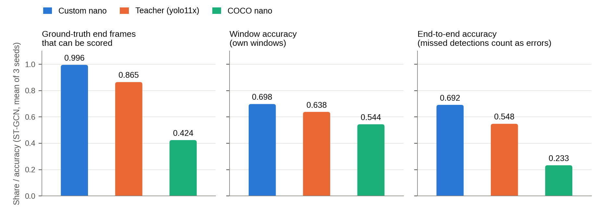

# 온디바이스 Skeleton 기반 고객 행동 인식

- 대상 논문: 노재현, 「온디바이스에서의 Skeleton 기반 고객 행동 인식 모델 개발」, 한신대학교 석사학위논문, 2025
- 구성: YOLOv11n-Pose (자세추정) → StrongSORT (추적) → ST-GCN / LSTM (행동 분류)
- 상태: **피험자 분할 프로토콜(학습 1–20 / 검증 21–26 / 테스트 27–41)로 실험 완료** ([docs/RESULTS.md](docs/RESULTS.md))

```
영상/카메라 → YOLOv11n-Pose → 머리 5개 키포인트 제거(12개) → StrongSORT
           → 트랙별 30프레임 버퍼 → ST-GCN 또는 LSTM → 5개 행동 라벨
```

- 인식 행동: `Reach To Shelf`, `Retract From Shelf`, `Hand In Shelf`, `Inspect Product`, `Inspect Shelf`

---

## 1. 핵심 결과

- 평가: 피험자 27–41(28편)을 테스트로 분리, seed 42·43·44, 테스트는 best checkpoint로 한 번만 평가
- 자세추정 모델은 피험자 1–20의 영상만으로 학습

**행동 인식 (Custom skeleton, 테스트 피험자 15명)**

| 항목 | ST-GCN | LSTM |
|---|---|---|
| 테스트 정확도 (윈도우 5,862개) | **0.698 ± 0.001** | **0.691 ± 0.004** |
| 테스트 macro-F1 | 0.683 | 0.678 |
| 피험자 평균 정확도 [95% CI] | 0.699 [0.676, 0.719] | 0.692 [0.663, 0.720] |
| End-to-end 정확도 (정답 끝 프레임 5,892개) | 0.692 ± 0.002 | 0.687 ± 0.004 |
| 파라미터 | 1,018,413 | 353,549 |
| INT8 정확도 (dynamic weight-only) | — | 0.690 (FP32 0.691) |

- ST-GCN − LSTM 차이: +0.007, 95% CI [−0.009, +0.021] (피험자별 paired bootstrap) → **차이가 확인되지 않음**
- End-to-end: 정답 라벨에서 분모를 만들고, 검출 실패와 30장 미달을 오답으로 계산

**자세추정 모델 비교 (ST-GCN, seed 3개 평균)**

| 자세추정 모델 | skeleton이 남는 테스트 프레임 | End-to-end 정확도 | 공통 프레임 정확도 |
|---|---|---|---|
| Custom nano (피험자 1–20으로 학습) | 92.3% | **0.692** | **0.639** |
| 교사 yolo11x (COCO) | 84.3% | 0.548 | 0.589 |
| COCO nano | 62.2% | 0.233 | 0.533 |

- 공통 프레임: 세 모델이 모두 검출한 동일 프레임만으로 학습·평가. Custom − 교사 +0.041, 95% CI [0.015, 0.069]
- Custom은 교사의 pseudo-label로 학습했지만 교사보다 검출 범위가 넓고 공통 프레임에서도 정확도가 높음
- Custom pose의 교사 일치도: pose mAP50 0.879 / mAP50-95 0.434 (pseudo-label 대비, 평가 σ는 어깨·팔 ÷ 1.5로 표준 COCO 표가 아님)

**온디바이스 (Jetson Orin NX 16GB, 25W)**

| 구성 | fps | 프레임당 | 프로세스 메모리 |
|---|---|---|---|
| Custom pose + LSTM | **20.7** | 47.1 ms | 1.28 GB |
| Custom pose + ST-GCN | 17.5 | 56.0 ms | 1.28 GB |

- 논문(0.93 / 0.85, mAP 0.90 / 0.66)과는 분할·평가 조건이 달라 직접 비교하지 않음
- 상세: [docs/RESULTS.md](docs/RESULTS.md) / 논문 초안: [docs/PAPER_DRAFT.md](docs/PAPER_DRAFT.md)



---

## 2. 빠른 시작

### 2.1 준비된 산출물

| 파일 | 내용 |
|---|---|
| `.venv/` | CUDA 동작하는 Jetson 전용 PyTorch 환경 |
| `weights/custom_yolo11n_pose_s1_20.pt` | 상단 시점 자세추정 (피험자 1–20으로 학습) |
| `weights/yolo11n-pose.engine` | 기존 COCO 모델 TensorRT 엔진 |
| `runs/subject_split/action/e1_custom_stgcn_s42/best.pt` | ST-GCN 행동 모델 (테스트 0.699) |
| `runs/subject_split/action/e1_custom_lstm_s42/best.pt` | LSTM 행동 모델 (테스트 0.694) |
| `data/raw/merl/` | 영상 106개 + 라벨 106개 (1.8 GB) |
| `data/processed/subject_split/custom_{train,val,test}.npz` | 피험자 분할 skeleton |
| `figures/subject_split/` | 피험자 분할 실험 그림 4종 |
| `figures/*.png` | 이전 실험의 그림 22종 + 주석 영상 (참고용, 현재 수치와 무관) |

- **Jetson에서는 `.venv/bin/python`을 사용할 것** (시스템 `python3`는 CPU 전용, §5 참조)
- `weights/custom_yolo11n_pose.pt`는 이전 가중치이며 사용하지 않음 (pseudo-label에 피험자 21–41 포함)

### 2.2 영상 파일로 실행

```bash
.venv/bin/python tools/run_recognition.py \
  --source data/videos/your_topview.mp4 \
  --pose-weights weights/custom_yolo11n_pose_s1_20.pt \
  --weights runs/subject_split/action/e1_custom_stgcn_s42/best.pt \
  --set runtime.max_fps=10 \
  --save-video runs/demo/annotated.mp4 \
  --save-csv runs/demo/actions.csv \
  --save-summary runs/demo/summary.json \
  --no-display
```

- 간편 실행: `bash scripts/run_video.sh data/videos/your_topview.mp4`

| 출력 | 내용 |
|---|---|
| `annotated.mp4` | skeleton, 트랙 ID, 행동 라벨 |
| `actions.csv` | 프레임별 `track_id, bbox, action, score` |
| `summary.json` | fps, 단계별 지연, 메모리, 행동별 카운트 |

- `runtime.max_fps=10`: 행동 모델은 10 fps × 30프레임(3초)으로 학습됨. 30 fps 영상을 그대로 넣으면 1초 분량만 분류하게 됨
- 행동 모델 없이도 실행 가능 (자세추정 + 추적만 수행)
- `--no-display`: SSH 등 화면 없는 환경용

### 2.3 카메라로 실행

```bash
# 연결 확인
.venv/bin/python -c "from car.utils.video import list_cameras; print(list_cameras())"

# USB 웹캠
bash scripts/run_camera.sh 0

# Jetson CSI(MIPI) 카메라
bash scripts/run_camera.sh 0 --csi

# IP 카메라
bash scripts/run_camera.sh "rtsp://user:pw@192.168.0.10:554/stream1"

# 화면 없는 환경
bash scripts/run_camera.sh 0 --no-display
```

- 결과는 `runs/live/<타임스탬프>/`에 저장
- CSI 카메라는 GStreamer `nvarguscamerasrc` 경유 (V4L2로는 열리지 않음)
- Jetson 튜닝 프로파일: `--config configs/jetson.yaml`

### 2.4 천장 카메라 설치 시 확인 사항

| 항목 | 기준 |
|---|---|
| 높이 | 어깨·팔·엉덩이가 모두 보일 것 (머리만 보이면 인식 불가) |
| 구도 | 선반이 프레임 상단에 오도록 배치 |
| 조명 | 역광 및 천장 조명 반사 회피 |
| 각도 | 학습 데이터와 다르면 §3의 자체 데이터 학습 권장 |

---

## 3. 학습

### 3.1 MERL Shopping 데이터 준비

- 이미 `data/raw/merl/`에 준비됨. 다른 장치에서 새로 받으려면:

```bash
mkdir -p data/raw/merl && cd data/raw/merl
BASE=https://www.merl.com/pub/tmarks/MERL_Shopping_Dataset
curl -LO $BASE/Videos_MERL_Shopping_Dataset.zip    # 1.7 GB
curl -LO $BASE/Labels_MERL_Shopping_Dataset.zip
unzip -q Videos_MERL_Shopping_Dataset.zip && unzip -q Labels_MERL_Shopping_Dataset.zip
rm -rf __MACOSX *.zip
mv Videos_MERL_Shopping_Dataset videos && mv Labels_MERL_Shopping_Dataset labels
```

| 항목 | 값 |
|---|---|
| 구조 | `videos/{피험자}_{세션}_crop.mp4`, `labels/{피험자}_{세션}_label.mat` |
| 라벨 형식 | MATLAB `tlabs` 셀 배열, 행동별 `[시작, 끝]` 프레임 |
| 분할 | 학습 1–20 (60개), 검증 21–26 (18개), 테스트 27–41 (28개) |

```bash
# 분할별로 따로 추출 (train | val | test)
.venv/bin/python tools/extract_skeletons.py --merl data/raw/merl --split train \
  --out data/processed/subject_split/custom_train_raw.npz --fps 10 --keep-background \
  --set pose.weights=weights/custom_yolo11n_pose_s1_20.pt

# 프레임당 1명만 남김 (MERL은 1인 촬영)
.venv/bin/python tools/subject_split.py prepare \
  --raw data/processed/subject_split/custom_train_raw.npz \
  --out data/processed/subject_split/custom_train.npz
```

### 3.2 자체 촬영 영상 준비

- 행동별 폴더에 클립 배치:

```
data/videos/labeled/
  Reach To Shelf/     clip1.mp4 clip2.mp4
  Hand In Shelf/      clip3.mp4
```

```bash
.venv/bin/python tools/extract_skeletons.py --video-dir data/videos/labeled \
  --out data/processed/custom_skeletons.npz
```

- 클립 하나에 행동 하나면: `--video PATH --label "Reach To Shelf"`
- **한 명만 등장하는 영상이면 단일 트랙 병합 필수** (검출 끊김 시 윈도우 생성 실패)

```python
from car.datasets.sequence import SkeletonStore, keep_primary_track
s = keep_primary_track(SkeletonStore.load("data/processed/custom_skeletons.npz"))
s.save("data/processed/custom_primary.npz")
```

### 3.3 행동 모델 학습

```bash
# 프로토콜 전체 (전처리 → 학습 → 채점). 끝난 작업은 건너뛰므로 중단 후 재시작 가능
.venv/bin/python tools/run_subject_split.py

# 개별 학습: 학습·검증·테스트 파일을 따로 지정
.venv/bin/python -m car.train.train_action --model stgcn --seed 42 \
  --train-store data/processed/subject_split/custom_train.npz \
  --val-store data/processed/subject_split/custom_val.npz \
  --test-store data/processed/subject_split/custom_test.npz \
  --out runs/subject_split/action/e1_custom_stgcn_s42 \
  --set train.balance_ratio=1.5 train.epochs=120 train.early_stop_patience=20
```

| 규칙 | 내용 |
|---|---|
| 가중치 갱신 | 학습 파일만 사용 |
| 조기 종료 | 검증 파일의 accuracy만 사용 |
| 테스트 | 학습이 끝난 뒤 best checkpoint로 한 번만 평가 |
| 클래스 균형 | `train.balance_ratio=1.5`를 반드시 지정 (기본값 0). 학습에만 적용 |

| 출력 | 내용 |
|---|---|
| `best.pt` | 검증 정확도 최고 체크포인트 |
| `summary.json` | 검증·테스트 정확도, macro-F1, 혼동행렬, 윈도우 통계, 설정 |
| `test_per_subject.json` | 테스트 피험자별 정확도 |
| `confusion_matrix.png` | 테스트 혼동행렬 |
| `history.png` | 학습 곡선 |

- `--store`와 `--split-by`는 한 파일을 둘로 나누는 간이 모드이며 테스트셋이 없음. 데이터 없는 배관 검증(§4)에만 사용

### 3.4 자세추정 모델 학습

```bash
# 1. 대형 모델로 12관절 자동 라벨링 (피험자 1–20만, 검증은 영상 단위 20%)
.venv/bin/python tools/autolabel_pose.py --videos data/raw/merl/videos \
  --out data/processed/pose_dataset_s1_20 --teacher weights/yolo11x-pose.pt \
  --fps 1 --conf 0.6 --min-keypoints 8 --subjects 1-20 --val-ratio 0.2 --seed 42

# 2. YOLOv11n-Pose 파인튜닝
.venv/bin/python -m car.train.train_pose \
  --data data/processed/pose_dataset_s1_20/dataset.yaml \
  --weights weights/yolo11n-pose.pt --name custom_yolo11n_pose_s1_20 \
  --set pose_train.imgsz=480 pose_train.batch_size=24 pose_train.epochs=40 pose_train.patience=12
```

| 항목 | 값 |
|---|---|
| 교사 모델 | YOLOv11x-Pose |
| 채택 기준 | 검출 신뢰도 ≥ 0.6, 확신 관절 ≥ 8개, 프레임당 1명 |
| 생성 라벨 | 5,780장 (기각 2,370장), 학습 48편 / 검증 12편 |
| OKS σ | 어깨·팔꿈치·손목만 1.5로 나눔 (`dataset.yaml`의 `kpt_oks_sigmas`) |
| 학습 | 40 epoch, 교사 일치도 pose mAP50 0.879 |

- 행동 인식의 검증·테스트 피험자(21–41) 프레임은 pose 학습에 들어가지 않음

### 3.5 평가 및 시각화

```bash
# End-to-end 정확도: 정답 끝 프레임 전체가 분모, 검출 실패는 오답
.venv/bin/python tools/subject_split.py end2end \
  --checkpoint runs/subject_split/action/e1_custom_stgcn_s42/best.pt \
  --store data/processed/subject_split/custom_test.npz \
  --out runs/subject_split/action/e1_custom_stgcn_s42/end2end.json

# seed 평균, 피험자 bootstrap 신뢰구간, 모델 간 paired 차이
.venv/bin/python tools/subject_split.py aggregate \
  --runs runs/subject_split/action/e1_custom_stgcn_s4{2,3,4} \
  --versus runs/subject_split/action/e1_custom_lstm_s4{2,3,4}

# LSTM dynamic weight-only INT8 변환 + 테스트 평가
.venv/bin/python tools/subject_split.py int8 \
  --checkpoint runs/subject_split/action/e1_custom_lstm_s42/best.pt \
  --test-store data/processed/subject_split/custom_test.npz \
  --out runs/subject_split/action/e1_custom_lstm_s42/int8.pt
```

| `tools/subject_split.py` 하위 명령 | 내용 |
|---|---|
| `prepare` | 프레임당 1명만 남김, 17관절 store의 12관절 사본 생성 |
| `intersect` | 여러 pose 모델이 모두 검출한 프레임만 남김 |
| `stats` | 윈도우 수, 간격이 벌어진 윈도우 비율, 실제 시간 길이 |
| `end2end` | 정답 끝 프레임 기준 정확도 |
| `int8` | dynamic INT8 변환과 테스트 평가 |
| `aggregate` | seed 평균, bootstrap 신뢰구간, paired 차이 |

- 그림: `tools/subject_split.py report` 후 `tools/make_subject_split_figures.py` → `figures/subject_split/`
- `tools/make_figures.py`, `tools/make_analysis_figures.py`는 이전 실험의 그림을 만드는 도구이며 현재 수치와 무관

---

## 4. 데이터 없이 파이프라인 검증

```bash
.venv/bin/python tools/make_demo_skeletons.py --out data/processed/demo_skeletons.npz
.venv/bin/python -m car.train.train_action --store data/processed/demo_skeletons.npz \
  --model stgcn --set train.epochs=30
```

- `car/synthetic.py`가 상단 시점 5가지 행동의 관절 움직임을 합성
- **테스트 픽스처이며 데이터가 아님.** 정확도는 배관 검증 의미만 있음

---

## 5. Jetson 환경

### 5.1 검증 환경

| 항목 | 값 |
|---|---|
| 보드 | Jetson Orin NX 16GB (Super) |
| L4T / JetPack | 36.4.4 / JetPack 6.2 |
| Python / PyTorch | 3.10.12 / 2.9.1 (Jetson 전용 휠) |
| CUDA / TensorRT | 12.6.68 / 10.3.0.30 |
| OpenCV | 5.0 (JetPack 제공) |
| 전력 모드 | 25 W |

- 논문 환경은 Jetson AGX Xavier 32GB / CUDA 11.4 → fps·메모리 직접 비교 불가

### 5.2 GPU 활성화 (중요)

- **pip 기본 `torch`는 Jetson에서 GPU를 인식하지 못함** (`cuda.is_available()` → `False`)
- 코드는 동작하나 전부 CPU로 실행되어 매우 느림

```bash
.venv/bin/python -c "import torch; print(torch.cuda.is_available())"   # True여야 함
```

- 새 장치 설치: `bash scripts/setup_jetson.sh`
- 수동 설치 시 주의사항:

```bash
python3 -m venv --system-site-packages .venv
# python3-venv 없으면: pip install --user virtualenv && python3 -m virtualenv --system-site-packages .venv

# ⚠️ --extra-index-url로 PyPI를 함께 주면 pip가 PyPI의 CPU 휠을 선택함
.venv/bin/pip install --no-deps --index-url https://pypi.jetson-ai-lab.io/jp6/cu126 \
  torch==2.9.1 torchvision==0.24.1

# ⚠️ libcudss.so.0 누락 문제
.venv/bin/pip install --no-deps --index-url https://pypi.jetson-ai-lab.io/jp6/cu126 \
  nvidia-cudss-cu12

.venv/bin/pip install --no-deps ultralytics ultralytics-thop
.venv/bin/pip install filelock typing-extensions sympy networkx jinja2 fsspec pillow \
  numpy scipy pandas PyYAML matplotlib tqdm psutil py-cpuinfo polars nvidia-ml-py pytest
```

| JetPack | CUDA | 인덱스 |
|---|---|---|
| 6.x | 12.6 | `jp6/cu126` |
| 6.x | 12.8 | `jp6/cu128` |
| 5.x | 11.8 | `jp5/cu118` |

- cuDSS는 `site-packages/nvidia/cu12/lib`에 설치되어 동적 링커가 찾지 못함
- 본 저장소는 `_car_jetson_boot.py`와 동명 `.pth`로 인터프리터 시작 시 선로딩 처리

### 5.3 측정 성능

**자세추정 단독** (640 px, FP32 PyTorch, 사람이 계속 등장하는 테스트 영상 500프레임)

| 모델 | 지연 (평균) | p95 |
|---|---|---|
| Custom nano | 40.6 ms | 41.6 ms |
| COCO nano | 42.1 ms | 43.7 ms |
| 교사 yolo11x | 210.3 ms | 211.3 ms |

**전체 파이프라인** (새 Custom 가중치, 920×680)

| 구성 | fps | 자세추정 | 추적 | 행동분류 | 합계 | 프로세스 메모리 |
|---|---|---|---|---|---|---|
| Custom pose + LSTM | **20.7** | 40.4 ms | 1.9 ms | 4.7 ms | 47.1 ms | 1.28 GB |
| Custom pose + ST-GCN | 17.5 | 40.8 ms | 1.9 ms | 13.2 ms | 56.0 ms | 1.28 GB |

- 행동 모델은 10 fps 입력으로 학습되므로 처리 속도가 10 fps를 넘으면 충분

### 5.4 성능 튜닝 순서

| 순위 | 항목 | 명령 | 효과 |
|---|---|---|---|
| 1 | 전력 모드 | `sudo nvpmodel -m 0 && sudo jetson_clocks` | 최대 |
| 2 | TensorRT 변환 | `tools/export_models.py --pose ... --format engine --half` | 지연의 73–86%인 자세추정 단계를 줄임 (새 가중치로는 미측정) |
| 3 | 해상도 축소 | `--set pose.imgsz=480` | 자세추정 단계 단축 (미측정) |
| 4 | 분류 주기 | `--set runtime.action_every=3` | 행동분류 4.7–13.2 ms를 3프레임에 한 번으로 |
| 5 | FP16 | `--set pose.half=true` | 미측정 |
| 6 | 모델 선택 | LSTM 사용 | 1.18배 (20.7 vs 17.5 fps) |

- 모니터링: `jtop`

---

## 6. 배포용 변환

```bash
# ONNX
.venv/bin/python tools/export_models.py --checkpoint runs/subject_split/action/e1_custom_stgcn_s42/best.pt --format onnx

# TensorRT (Jetson 권장)
.venv/bin/python tools/export_models.py --pose weights/custom_yolo11n_pose_s1_20.pt --format engine --half

# int8 동적 양자화
.venv/bin/python tools/export_models.py --checkpoint runs/subject_split/action/e1_custom_lstm_s42/best.pt --format torch-int8
```

| 경로 | 대상 | 비고 |
|---|---|---|
| TensorRT FP16/INT8 | Jetson **(권장)** | GPU 사용 |
| int8 TFLite | 논문 재현 | `onnx2tf` + `tensorflow` 필요 |
| PyTorch dynamic int8 | 툴체인 없는 CPU | Linear/LSTM만 대상 |

**LSTM dynamic weight-only INT8 (테스트 피험자 27–41, seed 3개 평균)**

| 항목 | FP32 | INT8 |
|---|---|---|
| 파일 크기 | 1.42 MB | **0.39 MB** (−73%) |
| 테스트 정확도 | 0.6913 | 0.6903 |
| FP32와 예측 일치 | — | 97.9% |

- ST-GCN은 Conv2d 기반이라 이 변환으로 크기가 변하지 않음 (정확도 유지 주장 없음)
- 상세: [docs/DEPLOYMENT.md](docs/DEPLOYMENT.md)

---

## 7. 논문 미기재 항목과 구현 결정

| 항목 | 논문 | 본 구현 | 근거 |
|---|---|---|---|
| Skeleton 정규화 | 미기재 | 몸통 기준 | 0.849 vs bbox 0.831 vs 없음 0.644 |
| 학습 데이터 증강 | 미기재 | 회전 ±30° | 0.839 vs ±180° 0.784 vs 없음 0.730 |
| 학습/검증/테스트 분할 | "70/30"만 | 피험자 단위 (1–20 / 21–26 / 27–41) | 겹치는 윈도우·같은 사람이 양쪽에 들어가지 않음 |
| 윈도우 라벨 | 미기재 | 마지막 프레임 | 실시간 추론 조건과 일치 |
| grouped conv 그룹 수 | "grouped conv" | 2 | 파라미터 922,301개 역산 |
| LSTM Dense 폭 | 미기재 | 32 | 파라미터 352,775개 역산 |
| StrongSORT ReID | 미기재 | HSV 히스토그램 | 온디바이스 2차 신경망 배제 |
| pose 라벨 제작 | "YOLO 포맷" | 대형 모델 pseudo-labeling (피험자 1–20만) | 수작업 비현실적, 테스트 피험자 배제 |

**파라미터 수 대조**

| 모델 | 논문 | 본 구현 | 차이 |
|---|---|---|---|
| LSTM | 352,775 | 353,549 | +0.2% |
| ST-GCN | 922,301 | 1,018,413 | +10.4% |

- 상세: [docs/PAPER_GAPS.md](docs/PAPER_GAPS.md)

---

## 8. 프로젝트 구조

```
car/
  config.py          설정 dataclass (# CHOICE = 논문 미기재 항목)
  keypoints.py       COCO-17 → 12관절, 머리 제거, 스켈레톤 그래프
  synthetic.py       합성 top-view 고객 (테스트 픽스처)
  datasets/
    merl.py          MERL .mat 라벨 파서, 공식 split
    extract.py       영상 → skeleton store
    sequence.py      store 저장, 윈도우 생성, 단일 트랙 병합
  models/
    graph.py         ST-GCN 인접행렬 분할
    stgcn.py         논문 그림 3.1 구조
    lstm.py          논문 그림 3.2 구조
  pose/
    estimator.py     YOLOv11n-Pose 래퍼 + 머리 제거
    tracker.py       StrongSORT 직접 구현
  pipeline/
    normalize.py     스켈레톤 정규화 3종
    buffer.py        트랙별 30프레임 버퍼 + 평활화
    realtime.py      end-to-end 실행기
  train/             train_pose, train_action, evaluate
  export/            ONNX / TensorRT / TFLite / int8
  utils/             video, viz, metrics
tools/               CLI 진입점 (subject_split.py, run_subject_split.py = 피험자 분할 실험)
configs/             default.yaml, jetson.yaml
docs/                RESULTS, PAPER_DRAFT, PAPER_GAPS, EXPERIMENTS, DEPLOYMENT, PIPELINE
```

---

## 9. 테스트

```bash
.venv/bin/python -m pytest tests/ -v
```

- 42개 테스트: 키포인트 처리, 그래프 구성, 정규화 불변성, 추적기 상태 전이, 버퍼 동작, 모델 입출력, 설정 로딩, 메트릭 계산

---

## 10. 문서

| 문서 | 내용 |
|---|---|
| [docs/RESULTS.md](docs/RESULTS.md) | 실험 절차, 결과, 논문 대비 변경점 요약 |
| [docs/PAPER_DRAFT.md](docs/PAPER_DRAFT.md) | 저널 투고용 국문 논문 초안 |
| [docs/PAPER_GAPS.md](docs/PAPER_GAPS.md) | 논문 미기재 항목 전체 목록 |
| [docs/EXPERIMENTS.md](docs/EXPERIMENTS.md) | 설계 선택 실험 상세 |
| [docs/DEPLOYMENT.md](docs/DEPLOYMENT.md) | 엣지 배포, 카메라 연결, 튜닝 |
| [docs/PIPELINE.md](docs/PIPELINE.md) | 단계별 구현 대응표 |
