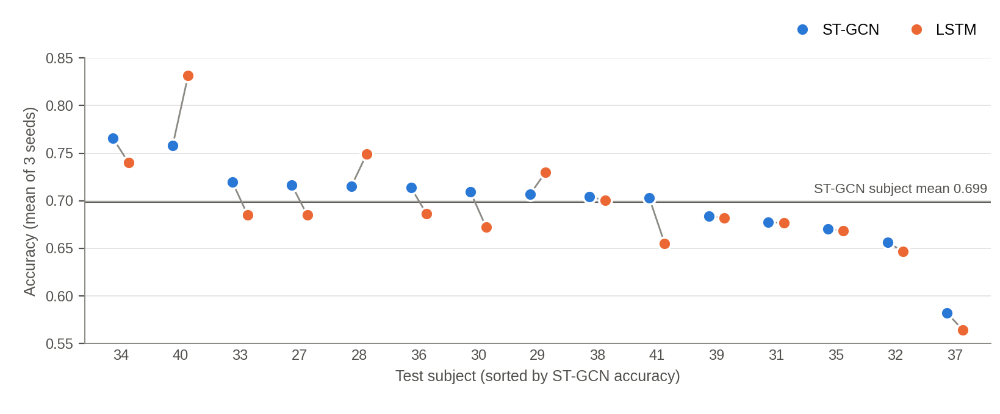
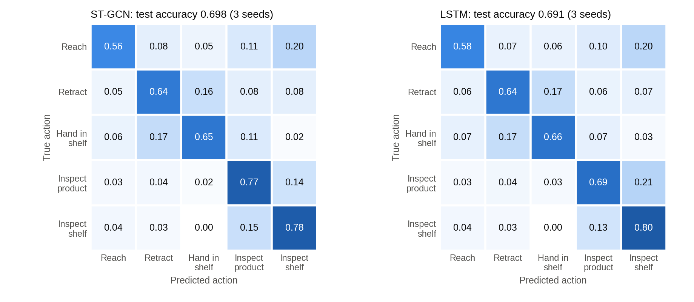
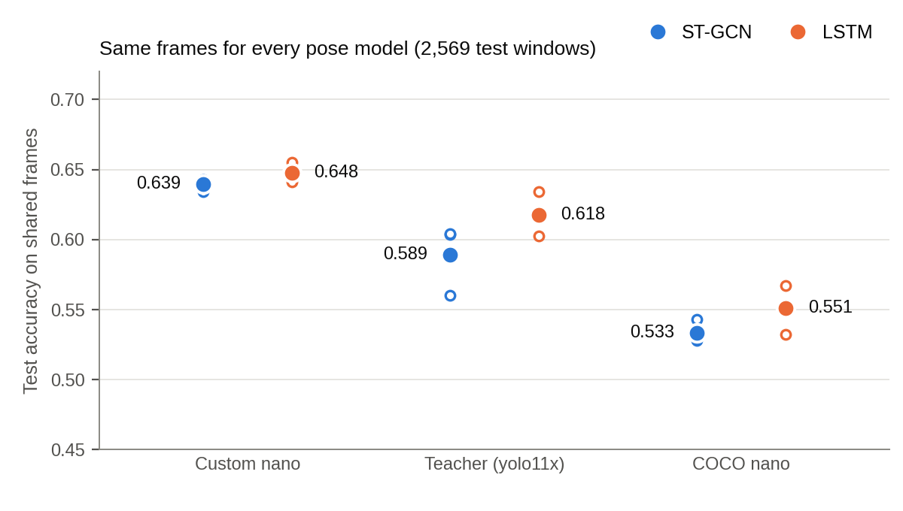

# 실험 절차 및 결과 요약

- 대상 논문: 노재현, 「온디바이스에서의 Skeleton 기반 고객 행동 인식 모델 개발」, 한신대학교 석사학위논문, 2025
- 측정 장비: NVIDIA Jetson Orin NX 16GB (JetPack 6.2, CUDA 12.6, 전력 모드 25W)
- 데이터: MERL Shopping Dataset (영상 106개, 피험자 41명)
- 프로토콜: 피험자 분할 (학습 1–20 / 검증 21–26 / 테스트 27–41), seed 42·43·44
- 프로토콜 원문: `runs/subject_split/PROTOCOL.md`
- 집계 원본: `runs/subject_split/eval/report.json` (`tools/subject_split.py report`)

> **이 문서의 수치만 유효함.** 이전 문서에 있던 0.949, 0.701, 0.694, +12.7%p, 윈도우 25,627개, mAP 0.927과 기존 `custom_yolo11n_pose.pt`로 추출한 skeleton은 사용하지 않음 (§4 참조).

---

## 1. 프로토콜

### 1.1 분할

| 용도 | 피험자 | 영상 | 10 fps 프레임 |
|---|---|---|---|
| 학습 | 1–20 | 60편 | 81,230 |
| 검증 (조기 종료) | 21–26 | 18편 | 27,074 |
| 테스트 | 27–41 | 28편 | 38,563 |

- 데이터셋 ReadMe가 제시하는 피험자 분할과 동일
- 가중치 갱신은 학습 파일만, 조기 종료는 검증 파일의 accuracy만 사용
- 테스트 파일은 각 seed의 best checkpoint로 **한 번만** 평가
- 테스트 점수가 높은 seed를 고르지 않음. seed 3개를 모두 보고

### 1.2 Custom pose 학습

| 항목 | 값 |
|---|---|
| 사용 영상 | 피험자 1–20의 60편만 (21–41은 pose 학습·검증에 넣지 않음) |
| pose 검증 분할 | 영상 단위. 이름순 정렬 → seed 42 셔플 → 20% (12편). 한 영상의 프레임은 한쪽에만 포함 |
| 교사 | yolo11x-pose, 1 fps, 검출 신뢰도 ≥ 0.6, 확신 관절 ≥ 8개, 프레임당 1명 |
| 관절 | 머리 5개를 라벨 저장 전에 제거한 12관절 |
| OKS σ | COCO 신체 관절 σ에서 어깨·팔꿈치·손목만 1.5로 나눔 (데이터셋 yaml의 `kpt_oks_sigmas`) |
| 학습 | YOLO11n-pose, 480 px, batch 24, 40 epoch (patience 12) |

- pose 검증 분할은 checkpoint 선택에만 사용. 같은 피험자의 다른 회차가 pose 학습에 남을 수 있으나 행동 인식 테스트 피험자와는 겹치지 않음

### 1.3 Skeleton 추출

- 세 pose 모델(Custom nano, COCO nano, 교사 yolo11x)을 같은 분할·같은 설정(640 px, conf 0.35, FP32)으로 추출
- 샘플링 10 fps: `step = round(원본 fps / 10)`, `idx % step == 0`
- 추출 직후 `keep_primary_track` 적용: 프레임마다 박스 면적이 가장 큰 검출만 남기고 track id를 1로 통일
  - MERL은 1인 촬영이므로 StrongSORT의 ID는 평가에 들어가지 않음. 추적 on/off 비교는 하지 않음
- COCO 계열 두 모델은 17관절 출력에서 `drop_head`로 12관절이 된 것을 로그로 확인 (세 모델 모두 12관절)
- 교사는 17관절로 한 번 추출하고, 12관절 store는 같은 행에 `drop_head`를 적용해 만듦

### 1.4 윈도우와 채점

| 항목 | 값 |
|---|---|
| 윈도우 | 저장된 검출 30개. 같은 클립에서 원본 프레임 번호 차이가 1–12인 검출만 연결 |
| 결측 처리 | 보간·0 채움 없음. 간격이 12를 넘으면 구간을 나누고, 30개 미만 구간은 윈도우를 만들지 않음 |
| 라벨 | 마지막 검출의 라벨 |
| stride | 학습·검증·테스트 모두 5 |
| 정규화 | 윈도우 30장의 torso 척도 중앙값 (클립 전체가 아님) |
| 클래스 균형 | `train.balance_ratio=1.5`, 학습에만 적용. 검증·테스트는 원래 분포 |
| 증강 | 회전 ±30°, 스케일 ±15%, 지터 0.01, 좌우 반전(좌·우 관절 교환) |
| 학습 | epoch ≤ 120, patience 20, batch 128, Adam 1e-3, FP32 |
| 주 정확도 | 윈도우별 argmax. 최근 5개 다수결과 신뢰도 0.4는 화면 출력용이며 수치에 넣지 않음 |

### 1.5 지표

- accuracy, macro-F1, 혼동행렬, 피험자별 accuracy (seed마다 저장)
- **주 신뢰구간**: 피험자별 정확도를 seed 3개에서 평균한 15명을 bootstrap (10,000회, 95%)
- **모델 간 비교**: 피험자별 정확도 차이의 paired bootstrap. 각 모델 구간의 겹침만으로 우열을 판단하지 않음

### 1.6 End-to-end 정확도

- 분모는 npz 행이나 학습용 윈도우 목록이 아니라 **정답 라벨**에서 만듦
- 각 테스트 영상의 `.mat`를 `frame_labels`로 읽고, 10 fps 샘플 인덱스 `j`에서 `j % 5 == 0`인 프레임을 끝 프레임으로 잡음
- 끝 프레임의 라벨이 다섯 행동 중 하나인 경우만 분모에 포함 (테스트 28편에서 5,892개)
- 끝 프레임마다 그 프레임에서 끝나고 간격 조건(≤ 12)을 만족하는 최근 검출 30장으로 윈도우를 직접 구성
- **끝 프레임에 검출이 없거나 30장이 안 되면 오답**
- pose 모델별 end-to-end에는 그 pose 모델의 전체 학습 skeleton으로 학습한 분류기를 사용
- 한계: 배경 구간에서 행동을 잘못 출력하는 경우는 이 분모에 없음

---

## 2. 결과

### 2.1 Custom pose (교사 일치도)

| 지표 | 값 |
|---|---|
| 라벨 프레임 | 5,780 (기각 2,370) |
| 학습 / 검증 이미지 | 4,581 (48편) / 1,199 (12편) |
| box mAP50 / mAP50-95 | 0.995 / 0.933 |
| pose mAP50 / mAP50-95 | 0.879 / 0.434 |

- **교사(yolo11x) pseudo-label과의 일치도**이며 사람이 라벨링한 정답 대비 값이 아님
- 평가 σ가 표준 COCO 표가 아님 (어깨·팔 σ ÷ 1.5). 다른 문헌의 mAP와 직접 비교 불가
- 가중치: `weights/custom_yolo11n_pose_s1_20.pt`

### 2.2 추출 결과

**skeleton이 남은 프레임** (`keep_primary_track` 적용 후, 괄호는 샘플 프레임 대비 비율)

| 분할 | 샘플 프레임 | Custom nano | 교사 yolo11x | COCO nano |
|---|---|---|---|---|
| 학습 | 81,230 | 74,698 (92.0%) | 67,953 (83.7%) | 51,257 (63.1%) |
| 검증 | 27,074 | 25,074 (92.6%) | 21,937 (81.0%) | 15,446 (57.1%) |
| 테스트 | 38,563 | 35,584 (92.3%) | 32,509 (84.3%) | 23,980 (62.2%) |

- Custom nano는 pose 학습에 쓰지 않은 검증·테스트 피험자에서도 학습 피험자와 같은 수준(92%)을 유지
- 교사 모델보다 학생 모델이 더 많은 프레임에서 skeleton을 냄

**윈도우 (stride 5, 5개 클래스)**

| Pose | 학습 (균형 전 → 후) | 검증 | 테스트 | 간격 > 3인 테스트 윈도우 | 테스트 윈도우 길이 (중앙값 / p95 / 최대) |
|---|---|---|---|---|---|
| Custom nano | 12,117 → 8,783 | 4,196 | 5,862 | 0.17% | 2.9 / 2.9 / 3.2초 |
| 교사 yolo11x | 10,396 → 7,798 | 3,411 | 5,125 | 7.1% | 2.9 / 3.1 / 3.6초 |
| COCO nano | 5,698 → 4,924 | 1,683 | 2,587 | 19.7% | 2.9 / 3.3 / 4.2초 |
| 교집합 (세 pose 공통 프레임) | 5,647 → 4,883 | 1,644 | 2,569 | 19.4% | 2.9 / 3.2 / 4.2초 |

- 결측이 없으면 윈도우는 2.9초(30개 검출, 29개 간격). 간격 허용치가 12이므로 이론상 최장 11.6초이나 실제 최대는 4.5초 이하
- Custom nano에서는 간격이 벌어진 윈도우가 거의 없고, COCO nano에서는 5개 중 1개꼴

### 2.3 E1: Custom skeleton 행동 인식 (테스트 피험자 27–41)

**윈도우 단위 (5,862개, 윈도우별 argmax)**

| 모델 | seed 42 | seed 43 | seed 44 | 평균 ± 표준편차 | macro-F1 | 피험자 평균 [95% CI] |
|---|---|---|---|---|---|---|
| ST-GCN | 0.6989 | 0.6965 | 0.6989 | **0.698 ± 0.001** | 0.683 | 0.699 [0.676, 0.719] |
| LSTM | 0.6940 | 0.6871 | 0.6929 | **0.691 ± 0.004** | 0.678 | 0.692 [0.663, 0.720] |

**End-to-end (정답 끝 프레임 5,892개)**

| 모델 | seed 42 | seed 43 | seed 44 | 평균 ± 표준편차 | macro-F1 | 피험자 평균 [95% CI] |
|---|---|---|---|---|---|---|
| ST-GCN | 0.6909 | 0.6904 | 0.6943 | **0.692 ± 0.002** | 0.678 | 0.691 [0.670, 0.710] |
| LSTM | 0.6897 | 0.6819 | 0.6891 | **0.687 ± 0.004** | 0.675 | 0.687 [0.660, 0.715] |

- 채점 가능 비율 99.6%: 끝 프레임 검출 없음 0개, 30장 미달 25개 (오답 처리)

**ST-GCN − LSTM (피험자별 paired bootstrap)**

| 기준 | 평균 차이 | 95% CI | ST-GCN이 높은 피험자 |
|---|---|---|---|
| 윈도우 단위 | +0.007 | [−0.009, +0.021] | 15명 중 12명 |
| End-to-end | +0.004 | [−0.012, +0.020] | 15명 중 9명 |

- 차이의 신뢰구간이 0을 포함. **두 모델의 정확도 차이는 확인되지 않음**
- 파라미터는 ST-GCN 1,018,413개, LSTM 353,549개 (2.9배)



**클래스별 성능 (테스트, seed 3개 평균)**

| 클래스 | 윈도우 | ST-GCN P / R / F1 | LSTM P / R / F1 |
|---|---|---|---|
| Reach To Shelf | 1,000 | 0.735 / 0.563 / 0.637 | 0.723 / 0.579 / 0.643 |
| Retract From Shelf | 1,063 | 0.700 / 0.636 / 0.662 | 0.697 / 0.645 / 0.670 |
| Hand In Shelf | 753 | 0.667 / 0.647 / 0.653 | 0.638 / 0.664 / 0.651 |
| Inspect Product | 1,245 | 0.639 / 0.770 / 0.697 | 0.655 / 0.686 / 0.669 |
| Inspect Shelf | 1,801 | 0.753 / 0.781 / 0.765 | 0.722 / 0.796 / 0.757 |



- 가장 큰 오류는 Reach → Inspect Shelf (0.20), Retract ↔ Hand In (0.16–0.17), Inspect Product ↔ Inspect Shelf (0.13–0.21)
- 시간상 이어지는 행동 사이에서 혼동이 발생

### 2.4 LSTM dynamic weight-only INT8

| seed | FP32 | INT8 | FP32와 예측 일치 |
|---|---|---|---|
| 42 | 0.6940 | 0.6940 | 98.2% |
| 43 | 0.6871 | 0.6834 | 97.5% |
| 44 | 0.6929 | 0.6936 | 97.9% |
| 평균 | 0.6913 | 0.6903 | 97.9% |

- 파일 크기 1,422,037 → 385,367 bytes (72.9% 감소)
- 같은 테스트 윈도우 5,862개에 argmax로 평가. 정확도 변화 −0.001
- ST-GCN은 이 변환으로 크기가 변하지 않으므로 정확도 유지 주장을 하지 않음

### 2.5 E2: pose 모델 비교


**(a) 전체 skeleton으로 학습 — 각 pose 모델의 자체 윈도우와 end-to-end**

| Pose | 분류기 | 윈도우 정확도 (seed 3개) | End-to-end 정확도 | 채점 가능 비율 |
|---|---|---|---|---|
| Custom nano | ST-GCN | 0.698 ± 0.001 | **0.692 ± 0.002** | 99.6% |
| Custom nano | LSTM | 0.691 ± 0.004 | **0.687 ± 0.004** | 99.6% |
| 교사 yolo11x | ST-GCN | 0.639 ± 0.016 | 0.548 ± 0.017 | 86.5% |
| 교사 yolo11x | LSTM | 0.649 ± 0.012 | 0.562 ± 0.010 | 86.5% |
| COCO nano | ST-GCN | 0.544 ± 0.022 | 0.233 ± 0.009 | 42.4% |
| COCO nano | LSTM | 0.536 ± 0.013 | 0.227 ± 0.004 | 42.4% |

- 정답 끝 프레임 5,892개 중 채점하지 못한 수: Custom 25개, 교사 796개(검출 없음 234, 30장 미달 562), COCO nano 3,392개(검출 없음 1,577, 30장 미달 1,815)
- 윈도우 정확도는 각 pose 모델이 만든 윈도우에서만 계산하므로 검출 실패가 반영되지 않음. **pose 모델 간 비교는 end-to-end 정확도로 해야 함**

**End-to-end 차이 (피험자별 paired bootstrap)**

| 비교 | ST-GCN | LSTM |
|---|---|---|
| Custom − 교사 | +0.129 [0.092, 0.171], 14/15 | +0.096 [0.055, 0.148], 14/15 |
| Custom − COCO nano | +0.458 [0.404, 0.512], 15/15 | +0.458 [0.395, 0.523], 15/15 |
| 교사 − COCO nano | +0.329 [0.279, 0.380], 15/15 | +0.362 [0.311, 0.418], 15/15 |

**(b) 교집합 비교 — 세 pose가 모두 잡은 동일 프레임**

- 교집합 프레임: 학습 50,760 / 검증 15,177 / 테스트 23,804
- 윈도우: 학습 5,647 → 균형 후 4,883, 검증 1,644, 테스트 2,569. 세 pose에서 윈도우 구성이 동일함을 확인
- 균형 후 클래스별 학습 윈도우: Reach 953, Retract 1,055, Hand In 719, Inspect Product 1,078, Inspect Shelf 1,078
- 조기 종료는 검증 교집합의 accuracy만 사용



| Pose | 분류기 | seed 42 / 43 / 44 | 평균 ± 표준편차 | macro-F1 | 피험자 평균 [95% CI] |
|---|---|---|---|---|---|
| Custom nano | ST-GCN | 0.6411 / 0.6345 / 0.6427 | **0.639 ± 0.004** | 0.631 | 0.649 [0.616, 0.685] |
| Custom nano | LSTM | 0.6551 / 0.6469 / 0.6411 | **0.648 ± 0.007** | 0.642 | 0.662 [0.631, 0.698] |
| 교사 yolo11x | ST-GCN | 0.6037 / 0.5601 / 0.6041 | 0.589 ± 0.025 | 0.575 | 0.608 [0.570, 0.648] |
| 교사 yolo11x | LSTM | 0.6154 / 0.6026 / 0.6345 | 0.618 ± 0.016 | 0.606 | 0.636 [0.600, 0.675] |
| COCO nano | ST-GCN | 0.5278 / 0.5286 / 0.5430 | 0.533 ± 0.009 | 0.512 | 0.534 [0.506, 0.562] |
| COCO nano | LSTM | 0.5535 / 0.5321 / 0.5671 | 0.551 ± 0.018 | 0.541 | 0.558 [0.531, 0.588] |

**교집합 차이 (피험자별 paired bootstrap)**

| 비교 | ST-GCN | LSTM |
|---|---|---|
| Custom − 교사 | +0.041 [0.015, 0.069], 11/15 | +0.026 [0.006, 0.049], 11/15 |
| Custom − COCO nano | +0.115 [0.084, 0.147], 14/15 | +0.103 [0.071, 0.139], 14/15 |
| 교사 − COCO nano | +0.075 [0.040, 0.113], 12/15 | +0.078 [0.040, 0.114], 14/15 |

- 같은 프레임에서도 Custom이 교사보다 높고(구간이 0을 포함하지 않음), end-to-end에서는 차이가 더 큼
- 따라서 Custom의 기여를 **경량 증류로만 볼 수 없음**. 학생이 교사의 확신 프레임만으로 학습했는데도 교사가 놓치는 프레임까지 잡고(끝 프레임 채점 가능 99.6% vs 86.5%), 공통 프레임에서도 분류 정확도가 높음
- 단, 이것은 행동 분류 정확도 기준의 비교이며 관절 좌표의 정확도를 직접 잰 것은 아님 (사람 라벨 정답 없음)
- 교집합 정확도(0.64)는 Custom 전체 skeleton의 정확도(0.70)보다 낮음. 교집합은 COCO nano가 놓친 프레임이 빠져 윈도우의 19%에 간격이 생기고 학습 윈도우도 절반 수준이기 때문. "쉬운 프레임이라 낙관적"이라는 예상과 달리 낮게 나옴

**(c) 17관절 vs 12관절 — 교사 skeleton, 같은 프레임**

| 분류기 | 17관절 (seed 42 / 43 / 44) | 12관절 (seed 42 / 43 / 44) | 17 − 12 [95% CI] |
|---|---|---|---|
| ST-GCN | 0.647 ± 0.009 (0.6375 / 0.6494 / 0.6540) | 0.639 ± 0.016 (0.6369 / 0.6548 / 0.6238) | +0.016 [−0.008, +0.042], 9/15 |
| LSTM | 0.643 ± 0.007 (0.6445 / 0.6351 / 0.6482) | 0.649 ± 0.012 (0.6377 / 0.6478 / 0.6624) | +0.000 [−0.014, +0.014], 6/15 |

- 17관절 그래프는 `COCO17_EDGES`를 그대로 사용. 윈도우는 두 경우 동일(테스트 5,125개)
- 두 분류기 모두 차이의 95% 구간이 0을 포함. **머리 관절을 넣거나 빼는 것에 따른 정확도 차이는 확인되지 않음**
- 교사 17관절 출력에서 머리 관절의 신뢰도 (학습 / 검증 / 테스트 분할)

| 관절 | 평균 신뢰도 | 0.2 이하로 0 처리되는 비율 |
|---|---|---|
| 코 | 0.30 / 0.29 / 0.32 | 52.7% / 52.9% / 48.6% |
| 왼쪽 눈 | 0.22 / 0.20 / 0.23 | 63.1% / 65.3% / 60.1% |
| 오른쪽 눈 | 0.23 / 0.23 / 0.26 | 62.6% / 63.7% / 58.0% |
| 왼쪽 귀 | 0.61 / 0.62 / 0.62 | 8.3% / 8.4% / 7.3% |
| 오른쪽 귀 | 0.65 / 0.67 / 0.67 | 7.4% / 5.6% / 6.2% |

- 코와 눈은 절반 이상이 이미 0으로 지워지고, 귀는 대부분 남음 (신체 12관절의 0 처리 비율은 14–15%)
- 이 결과는 COCO 계열 교사 pose에서 머리 관절을 뺐을 때의 변화이며, Custom pose에 대한 주장이 아님

### 2.6 온디바이스 지연 (재측정)

**pose 지연 (640 px, FP32 PyTorch, 테스트 영상 27_2에서 사람이 계속 등장하는 500프레임)**

| Pose 모델 | 지연 (평균) | p95 |
|---|---|---|
| Custom nano (12관절) | 40.6 ms | 41.6 ms |
| COCO nano (17관절) | 42.1 ms | 43.7 ms |
| 교사 yolo11x (17관절) | 210.3 ms | 211.3 ms |

**전체 파이프라인 (새 Custom 가중치, 920×680 입력)**

| 구성 | fps | 자세추정 | 추적 | 행동분류 | 합계 | 프로세스 메모리 |
|---|---|---|---|---|---|---|
| Custom pose + LSTM | **20.7** | 40.4 ms | 1.9 ms | 4.7 ms | 47.1 ms | 1.28 GB |
| Custom pose + ST-GCN | 17.5 | 40.8 ms | 1.9 ms | 13.2 ms | 56.0 ms | 1.28 GB |

- 자세추정이 전체 지연의 73–86%를 차지. 행동 분류는 LSTM 4.7 ms, ST-GCN 13.2 ms (정규화와 배치 구성 포함)
- 교사 yolo11x는 nano 모델보다 약 5배 느려(210 ms, 4.7 fps) 온디바이스 실시간 처리에 부적합. Custom nano는 COCO nano와 같은 속도
- 측정 구간은 사람이 계속 등장하는 500프레임(테스트 영상 27_2의 원본 프레임 144부터)이며 분류기가 매 프레임 실행됨. 보드를 다른 프로세스와 공유하는 상태에서 측정

### 2.7 다시 재지 않는 항목

| 항목 | ST-GCN | LSTM |
|---|---|---|
| 파라미터 | 1,018,413 | 353,549 |
| FP32 파일 크기 | 4.13 MB | 1.42 MB |
| dynamic INT8 파일 크기 | (변화 없음) | 0.39 MB |

- 구조가 같으므로 기존 측정을 유지. 분류기 단독 지연도 다시 재지 않음

---

## 3. 해석

| 관찰 | 근거 |
|---|---|
| 미학습 피험자에서 정확도는 약 0.69–0.70 | E1 테스트, seed 간 표준편차 0.001–0.004 |
| ST-GCN과 LSTM의 차이는 확인되지 않음 | paired 차이 +0.007, 95% CI [−0.009, +0.021] |
| Custom pose에서는 검출 실패가 정확도에 거의 영향 없음 | 윈도우 0.698 vs end-to-end 0.692 |
| pose 모델 순위는 Custom > 교사 > COCO nano | end-to-end 0.69 / 0.55 / 0.23, 모든 paired 구간이 0 제외 |
| Custom의 이점은 검출률만이 아님 | 공통 프레임에서도 교사보다 +0.03–0.04 |
| 윈도우 정확도만 보면 pose 모델 차이가 과소평가됨 | COCO nano: 윈도우 0.54 vs end-to-end 0.23 |
| INT8 변환으로 LSTM 정확도는 유지 | 0.6913 → 0.6903 |
| 교사 pose에서 머리 관절의 유무는 차이를 만들지 않음 | 17 − 12: ST-GCN +0.016 [−0.008, +0.042], LSTM +0.000 [−0.014, +0.014] |
| 파이프라인은 10 fps 요구치를 넘음 | Custom pose + LSTM 20.7 fps, + ST-GCN 17.5 fps |

---

## 4. 사용하지 않는 기존 수치

| 기존 수치 | 사용하지 않는 이유 |
|---|---|
| 0.949 / 0.939 (프레임 단위 분할) | 겹치는 윈도우가 학습·검증 양쪽에 들어가는 분할 |
| 0.701 / 0.694 (클립 단위 분할) | 테스트셋 없이 검증 best epoch을 보고. pose 모델이 검증 클립의 프레임을 학습에 사용 |
| +12.7%p (pose 재학습 기여) | 두 pose 모델이 서로 다른 윈도우에서 평가됨 |
| 윈도우 25,627개 | 기존 pose 가중치로 추출한 skeleton 기준 |
| mAP-pose 0.927 / 0.885 | 로그의 열을 한 칸 밀려 읽은 값 (실제는 recall 0.927, mAP50 0.885). 또한 피험자 21–41 프레임이 pose 라벨에 포함됨 |
| `weights/custom_yolo11n_pose.pt`와 그 skeleton | pseudo-label에 피험자 21–41 포함 |
| 추적기 on/off 비교 (0.924 vs 0.921) | 1인 촬영 데이터에서는 추적기 평가가 성립하지 않아 프로토콜에서 제외 |

---

## 5. 한계

| 항목 | 내용 |
|---|---|
| 배경 구간 | end-to-end 분모에 배경 프레임이 없어, 배경에서의 오검출은 측정되지 않음 |
| pose 정답 | 교사 pseudo-label 대비 일치도. 사람 라벨 정답 없음 |
| 단일 데이터셋 | 실험실 촬영, 카메라 1대, 1인 촬영 |
| 추적 | 1인 촬영이므로 추적기의 ID 유지 성능은 평가되지 않음 |
| seed | 3개. 피험자 15명 기준 신뢰구간으로 보완 |
| 교집합 | 검출 실패 프레임이 빠져 시퀀스에 간격이 생기므로, 전체 skeleton 결과와 절대값을 비교할 수 없음 |

---

## 6. 재현 명령

```bash
# 1. pose pseudo-label (피험자 1–20) → 학습
.venv/bin/python tools/autolabel_pose.py --videos data/raw/merl/videos \
  --out data/processed/pose_dataset_s1_20 --teacher weights/yolo11x-pose.pt \
  --fps 1 --conf 0.6 --min-keypoints 8 --subjects 1-20 --val-ratio 0.2 --seed 42
.venv/bin/python -m car.train.train_pose --data data/processed/pose_dataset_s1_20/dataset.yaml \
  --weights weights/yolo11n-pose.pt --name custom_yolo11n_pose_s1_20 \
  --set pose_train.imgsz=480 pose_train.batch_size=24 pose_train.epochs=40 pose_train.patience=12

# 2. skeleton 추출 (세 pose 모델 × 세 분할)
bash runs/subject_split/chain_custom.sh       # 위 1단계 + Custom 추출
bash runs/subject_split/chain_baselines.sh    # COCO nano, 교사 yolo11x(17관절)

# 3. 전처리·학습·채점 전체 (작업 큐 75개, 끝난 작업은 건너뜀)
.venv/bin/python tools/run_subject_split.py

# 4. 집계와 그림
.venv/bin/python tools/subject_split.py report
.venv/bin/python tools/make_subject_split_figures.py
```

| 산출물 | 위치 |
|---|---|
| 모델별 결과 | `runs/subject_split/action/<실험>_<pose>_<모델>_s<seed>/` (`summary.json`, 혼동행렬, `test_per_subject.json`, `end2end.json`) |
| 실험 이름 | `e1`(Custom 전체), `e2full`(COCO nano·교사 전체), `e2isect`(교집합), `e2j17`(교사 17관절) |
| 집계 | `runs/subject_split/eval/report.json`, `report.md` |
| skeleton | `data/processed/subject_split/` |
| 그림 | `figures/subject_split/` |
